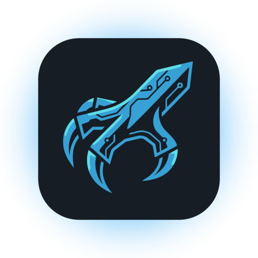
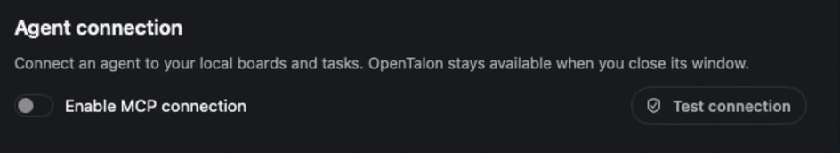
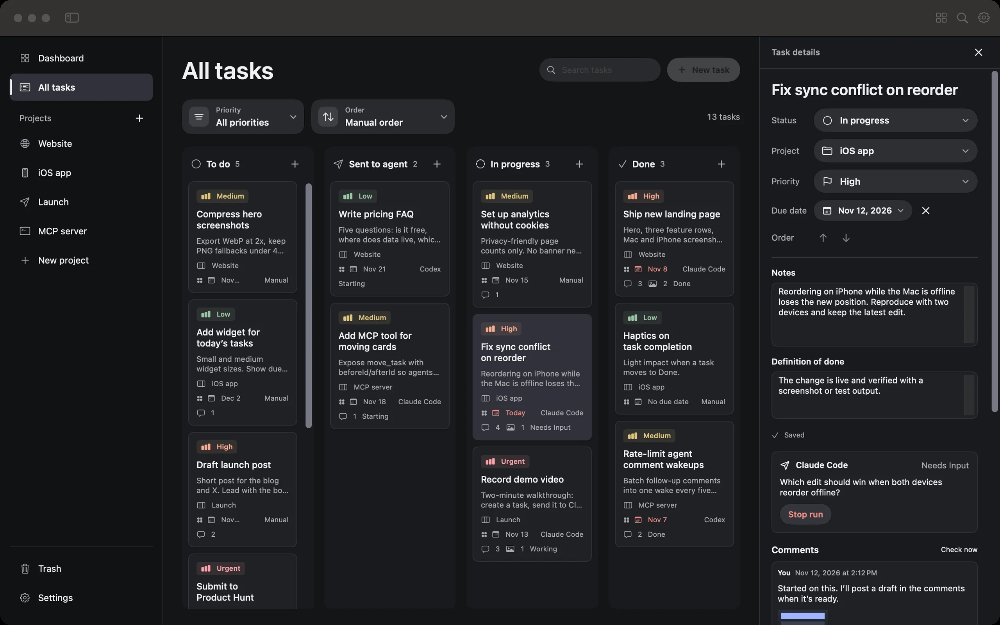
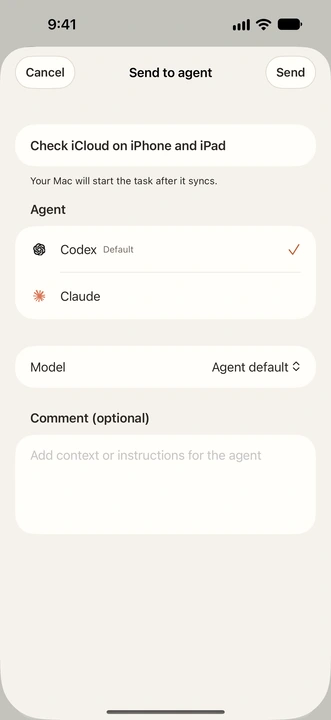
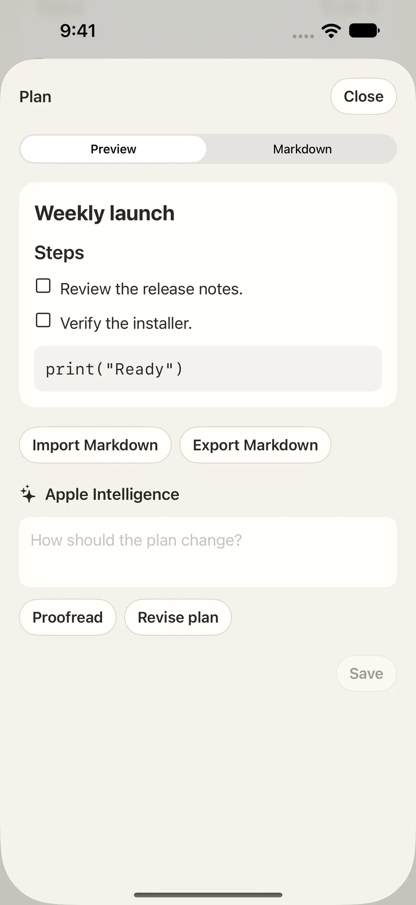
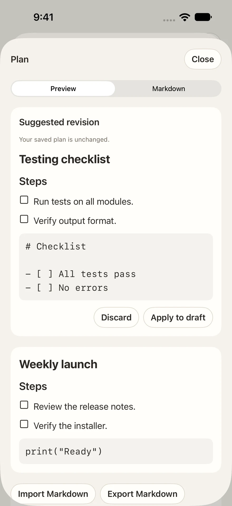

<p align="center">
  
</p>

<h1 align="center">OpenTalon</h1>

<p align="center"><strong>A personal Kanban board for your tasks and your agents.</strong><br>Native apps for Mac, iPhone, and iPad.</p>

<p align="center">
  <a href="https://opentalon.ai/download"><strong>Download for Mac</strong></a> ·
  <a href="#connect-codex-and-claude-through-mcp">MCP setup</a> ·
  <a href="#send-a-task-to-an-agent">Send to agent</a> ·
  <a href="#build-the-mac-app">Build it yourself</a> ·
  <a href="LICENSE">Source-available license</a>
</p>

---

## Plan your work on Mac

OpenTalon keeps your tasks, projects, notes, and attachments on your Mac. The board shows what’s ready to start, what you’ve handed off, and what’s done.


## Connect Codex and Claude through MCP

OpenTalon’s local Model Context Protocol (MCP) connection lets an agent read and update your boards from its chat.

1. On Mac, open **Settings → Agent connection**, turn on **Enable MCP connection**, and click **Test connection**.
2. For **Claude Code**, click **Save project connection…** in OpenTalon. Open the same folder in Claude’s **Code** tab and approve the connection when prompted.
3. For **Codex**, add a **STDIO** server under **Settings → MCP servers**. Copy the fields shown in OpenTalon’s Codex setup, then save and reload the server.

> “List my OpenTalon projects and tell me which tasks are in progress.”



## Send a task to an agent

On Mac, move a card to **Sent to agent**. Choose Codex or Claude and select a model when options are available. OpenTalon starts a saved conversation in your configured working folder and moves the card to **In progress** when the agent picks it up.

On iPhone or iPad, open a task and tap **Send to agent**. Choose the agent and model, add an optional comment, and confirm. Your Mac starts the work after the request syncs.

Follow progress on the card. Add feedback or a screenshot to continue in the same conversation, and read the completion report in **Comments**.

<table>
  <tr><th>Agent activity on Mac</th><th>Send to agent on iPhone</th></tr>
  <tr>
    <td align="center"></td>
    <td align="center"></td>
  </tr>
</table>

[Read the Send to agent guide](docs/SEND-TO-AGENT.md)

## Capture and follow up on iPhone and iPad

Capture a task on iPhone, then review the project on iPad. The companion syncs tasks, status updates, and queued agent handoffs with your Mac through your private iCloud database.

<table>
  <tr><th>Today on iPhone</th><th>Projects on iPad</th></tr>
  <tr>
    <td align="center"></td>
    <td align="center"></td>
  </tr>
</table>

*Native app screenshots use sample tasks.*

## Keep a Markdown plan with the task

Add a plan when creating a task, or open **Plan** below Notes and Definition of Done. Read the preview, edit the Markdown source, and import or export a `.md` file. Plans travel with the task through project changes, Archive, Trash, restore and backups, and are included when you send work to an agent.

On supported Apple Intelligence devices, proofread a plan or describe a revision. Review the suggestion, choose **Apply to draft**, then **Save**. The saved document stays unchanged until you save; conflicting edits keep your draft for review.

<table>
  <tr><th>Markdown plan preview</th><th>Review an AI revision</th></tr>
  <tr>
    <td align="center"></td>
    <td align="center"></td>
  </tr>
</table>

The sparkle button on iPhone and iPad opens **Ask OpenTalon**. Find tasks, create work, change task fields, or propose a plan by chatting. Requests run through the app's existing controls; sending to an agent still opens the agent, model and comment dialog. Keep multiple local chats, start a new one, or delete individual chats or all history without deleting your tasks.

Apple Intelligence uses the on-device system model on supported hardware with OS version 26 or later. Manual plan editing also works without it. Mobile changes save locally and queue for the Mac through private iCloud sync; both apps must be updated for plans.

## Build the Mac app

On an Apple Silicon Mac with Xcode and ImageMagick, run these commands from the repository root.

```sh
OPENTALON_NATIVE_SIGNING=adhoc OPENTALON_NATIVE_OUTPUT="$PWD/.local-build" ./native/build.sh
open .local-build/OpenTalon.app
```

This builds the SwiftUI app and bundles the Node.js service used by the local SQLite store and MCP server. Set `OPENTALON_PROFILE` when running a development build against a separate test workspace.

## Build for iPhone and iPad

Open `native/ios/OpenTalonPhone.xcodeproj` in Xcode and run the **OpenTalonPhone** scheme. To test iCloud sync on hardware, configure the Mac and mobile builds with bundle identifiers and a CloudKit container under your own Apple Developer team.

## Run tests

Run `node --test native/runtime/*.test.cjs native/integration.test.cjs` with Node.js 25 or later. Run `swift test --package-path native/CompanionCore` for the shared Swift tests.

See the guide for [backing up your board](docs/BACKUPS.md). For help with the apps, visit [OpenTalon Support](https://opentalon.ai/help).

## License

OpenTalon's original source is available under the [OpenTalon Source-Available License 1.0](LICENSE). It allows inspection, modification, internal use, and noncommercial redistribution subject to the license. Commercial distribution and monetized hosting require written permission from Protomota, LLC. Third-party components keep their own licenses.
