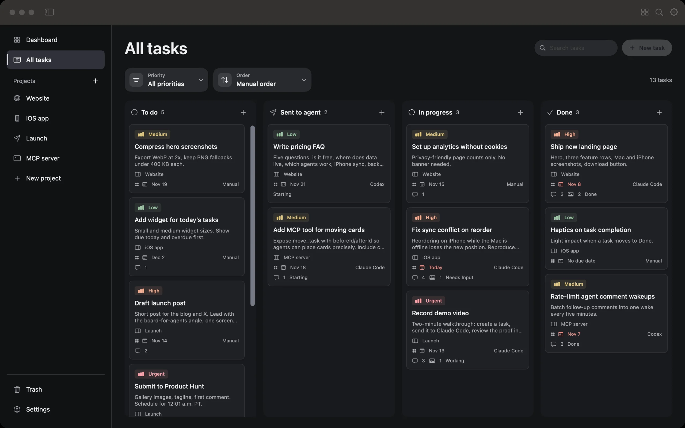
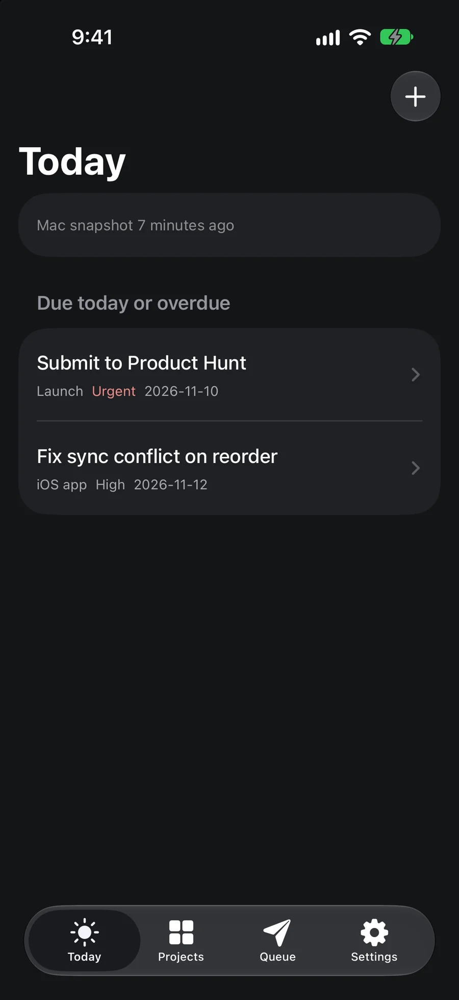
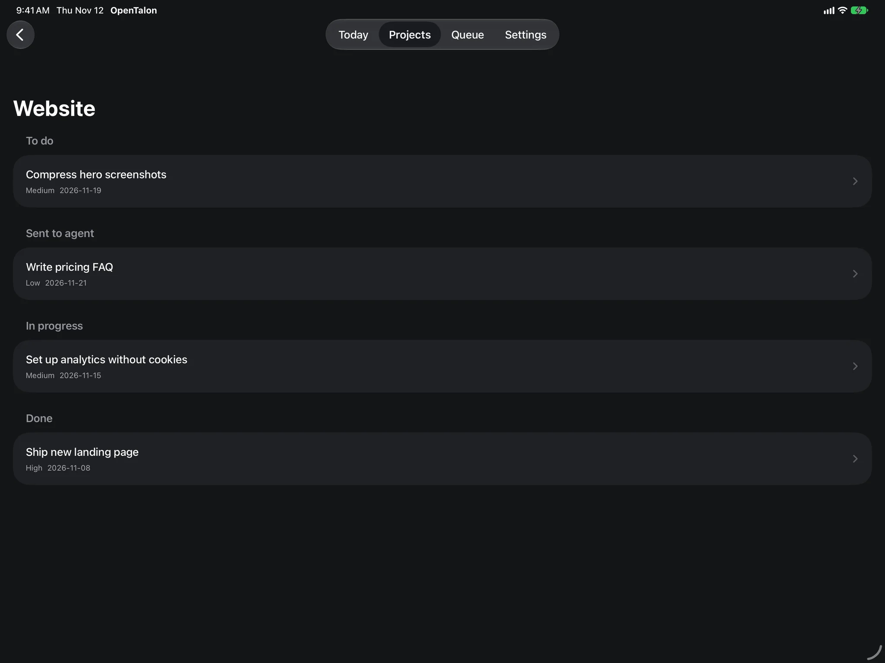

<p align="center">
  
</p>

<h1 align="center">OpenTalon</h1>

<p align="center"><strong>A personal Kanban board for your tasks and your agents.</strong><br>Native apps for Mac, iPhone, and iPad.</p>

<p align="center">
  <a href="https://opentalon.ai/download"><strong>Download for Mac</strong></a> ·
  <a href="#build-the-mac-app">Build it yourself</a> ·
  <a href="LICENSE">Source-available license</a>
</p>

---

## Plan your work on Mac

OpenTalon keeps your tasks, projects, notes, and attachments on your Mac. Move a card to **Sent to agent** to hand it to Codex or Claude, or connect either agent to your board through OpenTalon's local MCP server.



## Capture and follow up on iPhone and iPad

Capture a task on iPhone, then review the project on iPad. The companion syncs tasks, status updates, and queued agent handoffs with your Mac through your private iCloud database.

<table>
  <tr><th>Today on iPhone</th><th>Projects on iPad</th></tr>
  <tr>
    <td align="center"></td>
    <td align="center"></td>
  </tr>
</table>

*Native app screenshots use sample tasks.*

## Build the Mac app

On an Apple Silicon Mac with Xcode and ImageMagick, run these commands from the repository root.

```sh
OPENTALON_NATIVE_SIGNING=adhoc OPENTALON_NATIVE_OUTPUT="$PWD/.local-build" ./native/build.sh
open .local-build/OpenTalon.app
```

This builds the SwiftUI app and bundles the Node.js service used by the local SQLite store and MCP server. Set `OPENTALON_PROFILE` when running a development build against a separate test workspace.

## Build for iPhone and iPad

Open `native/ios/OpenTalonPhone.xcodeproj` in Xcode and run the **OpenTalonPhone** scheme. To test iCloud sync on hardware, configure the Mac and mobile builds with bundle identifiers and a CloudKit container under your own Apple Developer team.

## Run tests

Run `node --test native/runtime/*.test.cjs native/integration.test.cjs` with Node.js 25 or later. Run `swift test --package-path native/CompanionCore` for the shared Swift tests.

See the guides for [connecting an agent](docs/MCP-SETUP.md), [sending tasks](docs/SEND-TO-AGENT.md), and [backing up your board](docs/BACKUPS.md). For help with the apps, visit [OpenTalon Support](https://opentalon.ai/help).

## License

OpenTalon's original source is available under the [OpenTalon Source-Available License 1.0](LICENSE). It allows inspection, modification, internal use, and noncommercial redistribution subject to the license. Commercial distribution and monetized hosting require written permission from Protomota, LLC. Third-party components keep their own licenses.
